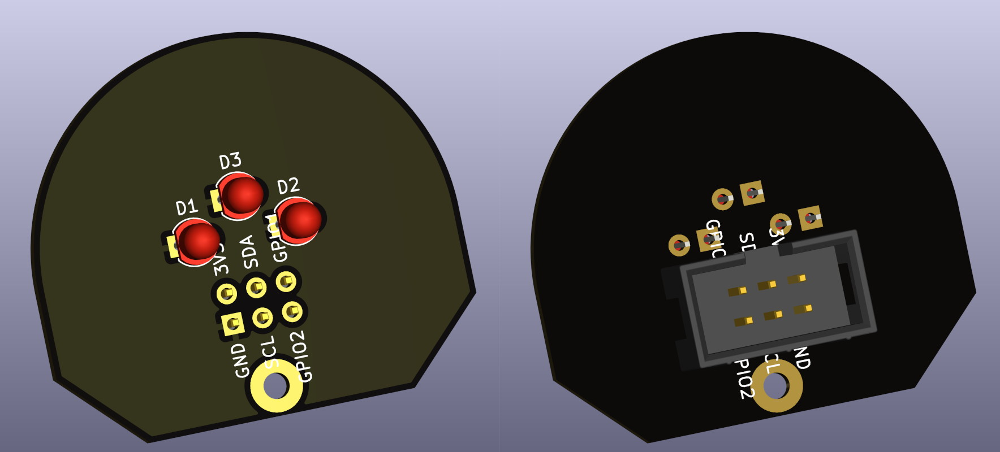

# Intoxicating Innocence SAO

The project consists of:
* PCB design (see [hardware/](./hardware/))

## PCB

The PCB was designed in KiCad. See `hardware/` for the source files and releases for generated outputs.

  

## License

This project is licensed under the `CERN-OHL-S-2.0` license - see the [LICENSE](LICENSE) file for details.
