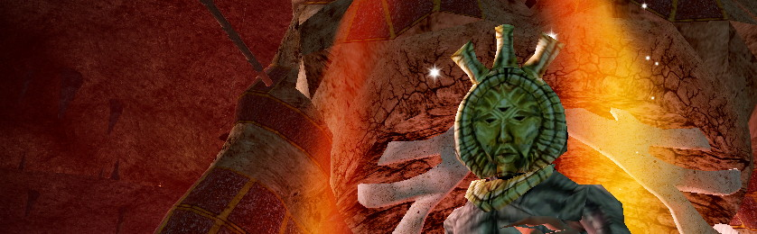
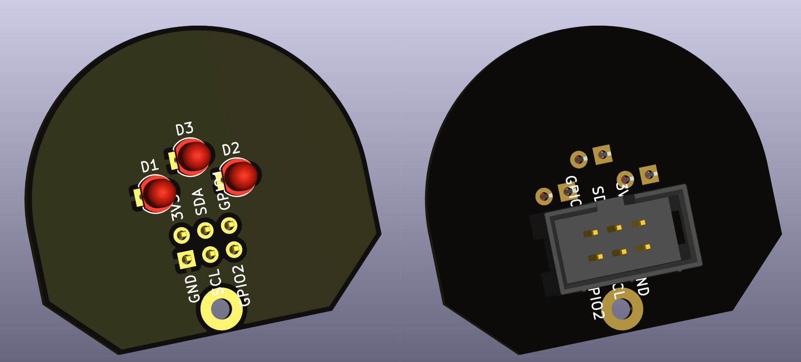

# Intoxicating Innocence SAO

A blinky [SAO (Simple Add-on/Shitty Add-on)](https://hackaday.io/project/52950-shitty-add-ons/log/159806-introducing-the-shitty-add-on-v169bis-standard) celebrating [Dagoth Ur](https://en.uesp.net/wiki/Lore:Dagoth_Ur), the beloved villain of [The Elder Scrolls 3: Morrowind (2002)](https://en.uesp.net/wiki/Morrowind:Morrowind). Just [listen to that voice](https://www.youtube.com/watch?v=fsXzoQte2kw)!

> What a fool you are. I'm a god. How can you kill a god? What a grand and intoxicating innocence. How could you be so naive? There is no escape. No Recall or Intervention can work in this place. Come. Lay down your weapons. It is not too late for my mercy. — *Dagoth Ur*

The project consists of:
* PCB design (see [hardware/](./hardware/))
* Mask model:
  * Front model (to be shared, [enclosure/mask/](./enclosure/mask/))
  * Negative volume, an envelope for the PCB and mounting elements (see [enclosure/pcb-envelope/](./enclosure/pcb-envelope/))

Some components are available in the repository only as scripts that generate resources.

## Assembly

It's quick - you only need a screwdriver (Hexagonal M2 or Torx 6) and light soldering.

> [!IMPORTANT]
> Before starting, check the contents of your kit. I have spares if anything is missing or damaged.
> You should have:
> * 3D‑printed mask model
> * Custom PCB
> * 1 shrouded SAO connector
> * 3 red LEDs
> * 1 M2 screw

1. Solder the LEDs with the red emitters **on the front side (with the quote)** (the short leg is negative pole and goes through the square GND pad).
2. Solder the SAO connector **on the back side (with the SMD components)**.
3. Insert the PCB into the 3D-printed mask, LEDs first. Screw the PCB in place.

> [!TIP]
> The programming pads are on a 0.1" grid for easy access.
> You only need `3V3`, `GND`, and `SWIO`; they are in a straight line.
>
> For flashing, use PlatformIO with the open‑source
> **[minilink](https://github.com/cnlohr/ch32fun/blob/master/minichlink/README.md)** programmer.
> Elliot also wrote a [Pico‑based flasher](https://github.com/hexagon5un/pico_ch32v003_prog/) (not tested by me).

## PCB

The PCB was designed in KiCad. See `hardware/` for the source files and releases for generated outputs.

  

## License

This project is licensed under the `CERN-OHL-S-2.0` license - see the [LICENSE](LICENSE) file for details.
